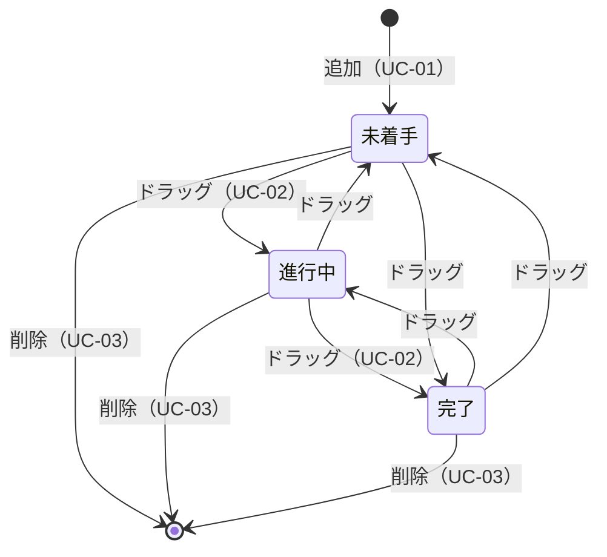

# ユースケース・操作フロー

[← 要件定義書に戻る](../要件定義書.md)

利用者が何をするか、どう動くかをまとめます。利用者は本人1名のため、登場人物は「利用者」だけとします。

## 1. ユースケース一覧
| ID | ユースケース | 目的 | 関連する機能 |
|---|---|---|---|
| UC-01 | タスクを追加する | やるべきことを忘れないよう記録する | F-02 |
| UC-02 | 作業の進み具合を更新する | タスクの状態（未着手→進行中→完了）を最新にする | F-03 |
| UC-03 | 不要なタスクを消す | ボードを見やすく保つ | F-04 |
| UC-04 | 前回の続きから使う | ブラウザを閉じても内容を失わない | F-05 |

## 2. 操作フロー
**UC-01 タスクを追加する**
1. 利用者が、追加したい列の入力欄にタスクの内容を入力する。
2. 「追加」ボタンを押す（または Enter キーを押す）。
3. 入力が空欄・空白のみの場合：カードは追加されず、赤文字で「タスクの内容を入力してください」と表示される。→ 1. に戻る。
4. 内容がある場合：その列の末尾にカードが表示され、入力欄は空になる。

**UC-02 作業の進み具合を更新する**
1. 利用者が、カードをマウスで掴む。
2. 移動先の列までドラッグし、マウスを離す（ドロップ）。
3. カードが移動先の列に表示される。

**UC-03 不要なタスクを消す**
1. 利用者が、消したいカードの右端の「×」を押す。
2. カードが消える。

**UC-04 前回の続きから使う**
1. 利用者が `index.html` をブラウザで開く（または再読み込みする）。
2. 前回保存したカードが、同じ列に表示される。

## 3. カードの状態遷移図
この画面は1枚だけなので、画面遷移の代わりに、カードがどの列を移動するかを示す。



## 4. 典型的な1日の流れ
```
朝：  「未着手」に今日のタスクを追加（UC-01）
  ↓
作業開始：カードを「進行中」へドラッグ（UC-02）
  ↓
作業終了：カードを「完了」へドラッグ（UC-02）
  ↓
不要になったカードを「×」で削除（UC-03）
  ↓
ブラウザを閉じる → 翌日開くと続きから使える（UC-04）
```

## 関連ドキュメント
- 機能の詳細：[02_機能要件](./02_機能要件.md)
- 画面：[04_画面設計](./04_画面設計.md)
