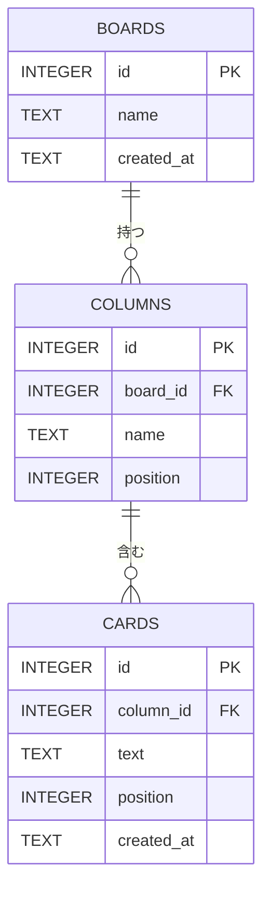
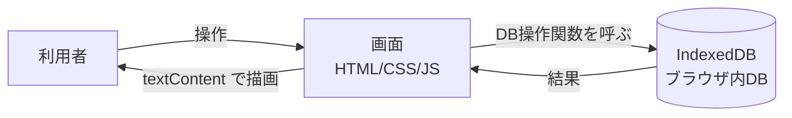

# データベース設計

[← 要件定義書に戻る](../要件定義書.md)

## 1. ER図
今回の画面は1ボードのみだが、将来の複数ボード・列の追加（F-07）に備え、3テーブルで設計する。

## 2. テーブル定義
IndexedDB では「テーブル」を「オブジェクトストア」と呼ぶ。以下の「型」は ER図上の分類で、IndexedDB 自体は型を強制しない。主キーの自動採番（autoIncrement）と、`cards` の `column_id` への索引（index）を設定する。

**boards（ボード）**
| 項目 | 型 | 制約 | 説明 |
|---|---|---|---|
| id | INTEGER | 主キー、自動採番 | ボードの識別子 |
| name | TEXT | NOT NULL | ボード名（例：タスク管理ボード） |
| created_at | TEXT | NOT NULL | 作成日時（ISO 8601形式） |

**columns（列）**
| 項目 | 型 | 制約 | 説明 |
|---|---|---|---|
| id | INTEGER | 主キー、自動採番 | 列の識別子 |
| board_id | INTEGER | NOT NULL、外部キー（boards.id） | 所属するボード |
| name | TEXT | NOT NULL | 列名（未着手／進行中／完了） |
| position | INTEGER | NOT NULL | 列の表示順（左から 0, 1, 2） |

**cards（カード）**
| 項目 | 型 | 制約 | 説明 |
|---|---|---|---|
| id | INTEGER | 主キー、自動採番 | カードの識別子 |
| column_id | INTEGER | NOT NULL、外部キー（columns.id） | 所属する列 |
| text | TEXT | NOT NULL | カードに表示する内容 |
| position | INTEGER | NOT NULL | 列内の表示順（F-08 で使用） |
| created_at | TEXT | NOT NULL | 作成日時（ISO 8601形式） |

- 初回起動時に、ボード1件と列3件（未着手・進行中・完了）を自動で作成する。
- 列を削除したときは、その列のカードも削除する（コードで実装する。IndexedDB は自動では消さない）。

## 3. データフロー図

## 4. DB操作関数一覧（画面とDBのやり取り）
| 関数名（案） | 内容 | 関連機能 |
|---|---|---|
| loadBoard() | ボード・列・カードをまとめて読み込む。初回は初期データを作る | F-01, F-05 |
| addCard(columnId, text) | カードを追加する | F-02 |
| moveCard(cardId, columnId) | カードを別の列へ移動する | F-03 |
| deleteCard(cardId) | カードを削除する | F-04 |

## 関連ドキュメント
- 機能：[02_機能要件](./02_機能要件.md)
- 画面との対応：[04_画面設計](./04_画面設計.md)
- データ整合性・保存の条件：[03_非機能要件](./03_非機能要件.md)
