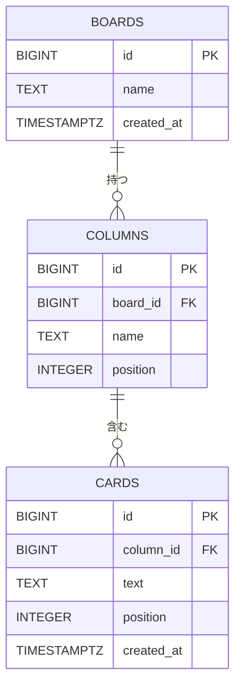
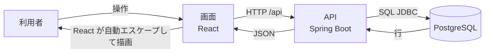

# データベース設計

[← 要件定義書に戻る](../要件定義書.md)

## 1. ER図
今回の画面は1ボードのみだが、将来の複数ボード・列の追加（F-07）に備え、3テーブルで設計する。

## 2. テーブル定義
データベースは PostgreSQL（Docker）。定義の実体は `backend/src/main/resources/schema.sql`（API 起動時に実行。何度実行しても安全）。主キーは自動採番（`GENERATED ALWAYS AS IDENTITY`）。

**boards（ボード）**
| 項目 | 型 | 制約 | 説明 |
|---|---|---|---|
| id | BIGINT | 主キー、自動採番 | ボードの識別子 |
| name | TEXT | NOT NULL | ボード名（例：タスク管理ボード） |
| created_at | TIMESTAMPTZ | NOT NULL、既定値は現在時刻 | 作成日時（タイムゾーン付き） |

**columns（列）**
| 項目 | 型 | 制約 | 説明 |
|---|---|---|---|
| id | BIGINT | 主キー、自動採番 | 列の識別子 |
| board_id | BIGINT | NOT NULL、外部キー（boards.id）、`ON DELETE CASCADE` | 所属するボード |
| name | TEXT | NOT NULL | 列名（未着手／進行中／完了） |
| position | INTEGER | NOT NULL | 列の表示順（左から 0, 1, 2） |

**cards（カード）**
| 項目 | 型 | 制約 | 説明 |
|---|---|---|---|
| id | BIGINT | 主キー、自動採番 | カードの識別子 |
| column_id | BIGINT | NOT NULL、外部キー（columns.id）、`ON DELETE CASCADE` | 所属する列 |
| text | TEXT | NOT NULL | カードに表示する内容 |
| position | INTEGER | NOT NULL | 列内の表示順（F-08 で使用） |
| created_at | TIMESTAMPTZ | NOT NULL、既定値は現在時刻 | 作成日時（タイムゾーン付き） |

- 索引：`columns.board_id`、`cards.column_id`。
- 初期データ：ボード1件と列3件（未着手・進行中・完了）を、`schema.sql` が自動で作成する（既にあれば作らない）。
- 列を削除すると、その列のカードも自動で削除される（外部キーの `ON DELETE CASCADE`）。コードでの削除処理は不要。
- 動作確認用のテストデータ：`db/seed_test_data.sql`（手動で実行。何度実行しても重複しない）。

## 3. データフロー図

## 4. API 一覧（画面とDBのやり取り）
画面はデータベースに直接アクセスせず、次の API を呼ぶ。JSON の項目名はキャメルケース（`columnId`、`createdAt`）。

| メソッドと URL | 内容 | 関連機能 | 状態 |
|---|---|---|---|
| `GET /api/board` | ボード・列・カードをまとめて取得する | F-01, F-05 | 実装済 |
| `GET /api/cards?columnId=&q=` | カード一覧。列（`columnId`）とキーワード（`q`）で絞り込める | F-09 | 実装済 |
| `GET /api/cards/{id}` | カードを1件取得する。無ければ 404 | - | 実装済 |
| `GET /api/board?q=` | ボードの列は常に3つのまま、カードだけをキーワードで絞り込む | F-09 | 未実装（予定） |
| `POST /api/cards` | カードを追加する | F-02 | 未実装 |
| `PATCH /api/cards/{id}` | カードを別の列へ移動する（案） | F-03 | 未実装 |
| `DELETE /api/cards/{id}` | カードを削除する | F-04 | 未実装 |

- 検索（`q`）は、カード本文への部分一致で、英字の大文字・小文字は区別しない。`%` や `_` も普通の文字として扱う。

## 5. 旧版（IndexedDB）について
旧版の `index.html` は、ブラウザ内の IndexedDB に保存していた（データベース名 `taskboard`、オブジェクトストア3つ）。現在の構成では使わない。

## 関連ドキュメント
- 機能：[02_機能要件](./02_機能要件.md)
- 画面との対応：[04_画面設計](./04_画面設計.md)
- 構成・技術：[07_技術要件](./07_技術要件.md)
- データ整合性・保存の条件：[03_非機能要件](./03_非機能要件.md)
