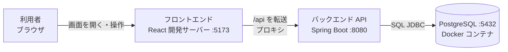

# 技術要件

[← 要件定義書に戻る](../要件定義書.md)

## 1. 全体構成

すべて利用者本人のPC（localhost）の中で動く。外部のサーバーやクラウドは使わない。

## 2. 使用する技術
| 層 | 技術 | 備考 |
|---|---|---|
| フロントエンド | React、TypeScript、Vite | `frontend/`。開発サーバーは 5173 番（固定） |
| バックエンド | Spring Boot（Java 17、Gradle）、Spring JDBC | `backend/`。API は 8080 番（固定）。`/api` 以下に公開 |
| データベース | PostgreSQL 17（Docker） | `docker-compose.yml`。5432 番は自分のPCからのみ接続可能 |
| 開発環境 | Docker Desktop、Java 17、Node.js | 本人のPCに導入済み |
| 変更管理 | GitHub（Issue → ブランチ → PR） | 運用ルールは [CLAUDE.md](../CLAUDE.md) |

### 2.1 バージョン一覧（2026-11-25 時点）
バージョンは次のファイルで決まる。更新したら、この表も直す。

**フロントエンド**（`frontend/package.json`、`package-lock.json`）
| 技術 | バージョン | 用途 |
|---|---|---|
| React、React DOM | 19.3.1 | 画面の部品 |
| TypeScript | 7.0.2 | 型のある JavaScript |
| Vite | 8.3.8（指定 `^8.3.6`） | 開発サーバー、ビルド |
| @vitejs/plugin-react | `^6.1.2` | Vite で React を使う |
| Oxlint | 1.95.0（指定 `^1.90.0`） | コードの静的検査（`npm run lint`） |
| Node.js、npm | 26.13.1、11.20.0 | 実行環境（開発PCの実測値） |

**バックエンド**（`backend/build.gradle.kts`、`gradle-wrapper.properties`）
| 技術 | バージョン | 用途 |
|---|---|---|
| Java | 17（開発PCは 17.0.21） | 実行環境。Gradle のツールチェーンで 17 を指定 |
| Spring Boot | 4.0.9 | API サーバー（`spring-boot-starter-webmvc`、`-jdbc`） |
| Gradle | 9.9.1 | ビルド（`./gradlew` で自動取得） |
| PostgreSQL JDBC ドライバ | Spring Boot が決めたもの | DB 接続（バージョンは指定しない） |

**データベース**（`docker-compose.yml`）
| 技術 | バージョン | 用途 |
|---|---|---|
| PostgreSQL | 17（Docker イメージ `postgres:17`） | データ保存 |

## 3. 方針
- **画面とデータの分離**：画面（React）はデータベースへ直接アクセスしない。必ずバックエンドの API を通す。
- **同じ場所に見せる**：フロントエンドの開発サーバーが `/api` をバックエンド（8080）へ転送する（プロキシ）。ブラウザは常に 5173 番だけを見るため、CORS（別オリジン間の通信制限）の設定は不要。
- **表示の安全性**：React の標準の表示（自動エスケープ）を使い、`dangerouslySetInnerHTML` は使わない。
- **SQL の安全性**：値は必ず `?` のパラメータで渡し、文字列連結で SQL を作らない。
- **バックエンドの構成**：Controller（URL の受付）→ Repository（SQL の実行）→ DB の3層に分ける。
- **非同期処理**：フロントの API 通信は `fetch` と `async/await` で書く。

## 4. 起動方法（目安）
1. `docker compose up -d`（`github-study` フォルダ）：PostgreSQL を起動
2. `./gradlew bootRun`（`backend` フォルダ）：API を起動。起動時に `schema.sql` が実行される
3. `npm run dev`（`frontend` フォルダ）：画面を起動。ブラウザで `http://localhost:5173` を開く
4. 動作確認用のデータは `db/seed_test_data.sql` を手動で流して入れる

API と画面は、`scripts/dev-servers.ps1`（`-Action start` / `stop` / `status`）でも起動・停止できる。ポートは 8080・5173 に固定で、使用中なら持ち主を停止してから起動する（[CLAUDE.md](../CLAUDE.md) の「7. 開発サーバーのポート」）。

## 5. 動作条件
- Docker Desktop、Java 17、Node.js が使える PC であること。
- 3つ（DB、API、画面）がすべて起動していること。1つでも止まっていると、画面にエラーを表示する。
- 旧版の `index.html`（ブラウザだけで動く IndexedDB 版）は参考として残す。本構成とは別物で、今後は更新しない。

## 6. 現状（2026-11-25 時点）
| 項目 | 状態 |
|---|---|
| PostgreSQL（Docker）、テーブル、初期データ | 完了 |
| 読み取り API（ボード全体、カード一覧・絞り込み、カード1件） | 完了 |
| フロントエンド環境（React） | 完了 |
| ボード表示（F-01、表示のみ） | 完了 |
| 書き込み API（追加・移動・削除） | 未着手 |

## 関連ドキュメント
- データ構造・API：[06_データベース設計](./06_データベース設計.md)
- 品質面の条件：[03_非機能要件](./03_非機能要件.md)
