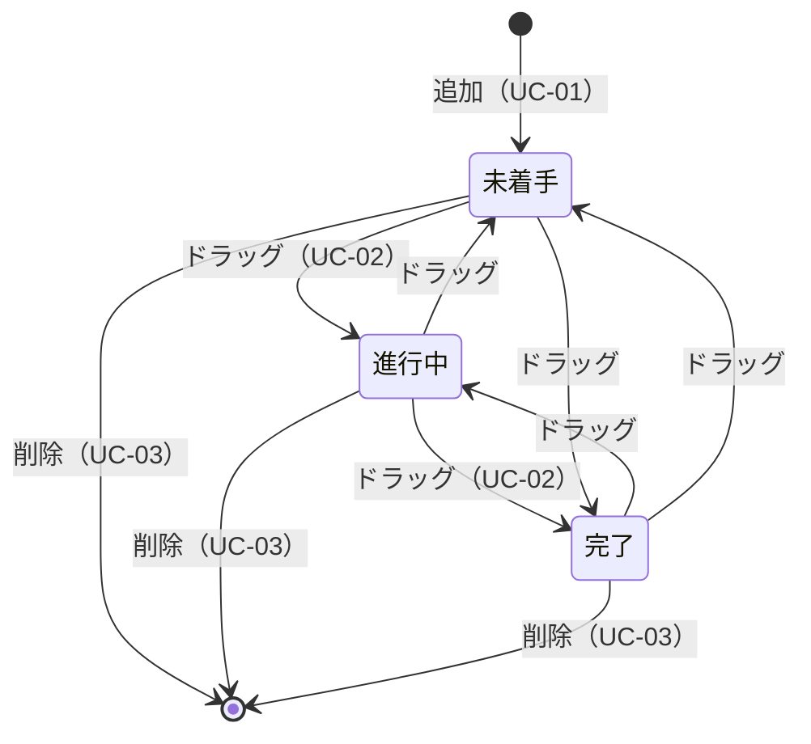
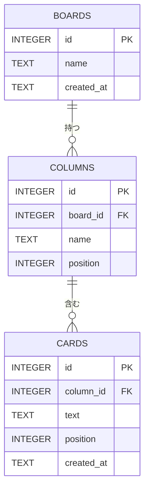
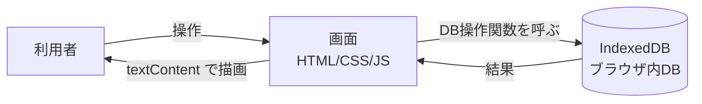

# 要件定義書：Trello風タスク管理アプリ

作成日：2026-11-06　／　対象ファイル：`index.html`

## 1. 目的・背景
- Trelloのように、タスクをカードとして列に並べて管理できる簡易アプリを作る。
- プログラミング学習（HTML / CSS / JavaScript）を兼ねた、最小構成の個人用ツールとする。

## 2. 対象ユーザー
- 利用者：本人1名（ログイン不要）
- 利用環境：PCのブラウザ（Microsoft Edge、Chrome の最新版）

## 3. スコープ（作る範囲・作らない範囲）
### 3.1 対象（作るもの）
- 3列（未着手／進行中／完了）のボード画面
- カードの追加・移動・削除
- ブラウザ内蔵データベース（IndexedDB）へのデータ保存（ボード・列・カードの3テーブル）

### 3.2 対象外（今回は作らないもの）
- ログイン、複数ユーザー、共有機能
- サーバー、他端末との同期、クラウドへの公開
- 期限、担当者、ラベル、コメント、添付ファイル
- スマートフォン向けの最適化

## 4. 機能要件（アプリにできてほしいこと）
| ID | 機能 | 内容 | 優先度 |
|---|---|---|---|
| F-01 | ボード表示 | 「未着手」「進行中」「完了」の3列を横に並べて表示する | 必須 |
| F-02 | カード追加 | 各列の入力欄にテキストを入力し、「追加」ボタンまたは Enter キーでその列にカードを追加する。空欄・空白のみの場合は追加せず、入力欄の下に赤文字で「タスクの内容を入力してください」と表示し、入力欄の枠も赤くする。文字を入力し始めるとエラー表示は消える | 必須 |
| F-03 | カード移動 | カードをドラッグ＆ドロップして別の列へ移動できる | 必須 |
| F-04 | カード削除 | カード右端の「×」ボタンでカードを削除できる | 必須 |
| F-05 | データ保存 | カードの内容と所属列を、ブラウザの IndexedDB に保存し、再読み込み・ブラウザ再起動後も復元する | 必須 |
| F-06 | カード編集 | 既存カードの文言を後から変更できる | 任意（次回） |
| F-07 | 列の追加・名称変更 | 列を増やしたり、名前を変更できる | 任意（次回） |
| F-08 | 同一列内の並べ替え | 列の中でカードの順番を変更できる | 任意（次回） |

## 5. 非機能要件（機能以外の品質や条件：使いやすさ・速さ・安全性など）
| 区分 | 内容 |
|---|---|
| 動作環境 | インストール不要。購入したてのPCでも、`index.html` をブラウザで開くだけで動作する |
| 使いやすさ | 初めて使う人が説明なしで、追加・移動・削除を操作できる |
| 性能 | 数十枚のカードで操作に遅延を感じない |
| 保存 | データは利用者のブラウザ内（IndexedDB）のみに保存し、外部へ送信しない |
| データ整合性 | IndexedDB には外部キーの自動チェックがないため、列の削除時にその列のカードも削除する処理をコードで行う |
| 安全性 | 入力文字は `textContent` で表示し、HTMLとして解釈させない |
| 保守性 | 1ファイル構成とし、CSS・HTML・JavaScript を区分してコメントを付ける。JavaScript 内では、DBアクセスの処理を画面描画の処理と分けて書く |

## 6. 画面設計
### 6.1 画面一覧
| 画面ID | 画面名 | 内容 | 関連する機能 |
|---|---|---|---|
| S-01 | タスク管理ボード画面 | 3列のボードを表示し、カードの追加・移動・削除を行う唯一の画面 | F-01〜F-05 |

画面遷移はなく、ページ内の表示だけが変わる（7.3章の状態遷移図を参照）。

### 6.2 S-01 レイアウト
```
+----------------------------------------------------------+
| ① タスク管理ボード                                         |
| +------------+  +------------+  +------------+           |
| | ② 未着手    |  | 進行中      |  | 完了        |           |
| | ③[カード ④×]|  |            |  |            |           |
| | ⑤[入力][追加]|  | [入力][追加]|  | [入力][追加]|           |
| | ⑥エラー表示 |  |            |  |            |           |
| +------------+  +------------+  +------------+           |
+----------------------------------------------------------+
```

### 6.3 部品一覧
| 番号 | 部品 | 内容 | 関連機能 / DB操作 |
|---|---|---|---|
| ① | 見出し | アプリ名を表示する | - |
| ② | 列 | 列名とカードを縦に並べる。ドロップ先になる | F-01 / loadBoard() |
| ③ | カード | タスクの文言を表示する。ドラッグできる | F-03 / moveCard() |
| ④ | 削除ボタン「×」 | カードを削除する | F-04 / deleteCard() |
| ⑤ | 入力欄・追加ボタン | 入力して「追加」または Enter でカードを追加する | F-02 / addCard() |
| ⑥ | エラー表示 | 空欄時に赤文字で「タスクの内容を入力してください」を表示する | F-02 |

### 6.4 画面の状態
| 状態 | 見た目 |
|---|---|
| 通常 | 青い背景（`#0079bf`）に3列を表示する |
| 列にカードがない | 入力欄だけを表示する |
| 入力エラー | ⑥を赤文字で表示し、入力欄の枠も赤くする。入力を始めると消える |
| ドラッグ中 | ドロップできる列を強調表示する（案） |

### 6.5 表示ルール
- 色：背景 `#0079bf`、エラーは赤
- 文字はすべて `textContent` で表示する
- 幅：PCのブラウザ向け。スマートフォンは対象外

## 7. ユースケース・操作フロー（利用者が何をするか、どう動くか）
利用者は本人1名のため、登場人物は「利用者」だけとする。

### 7.1 ユースケース一覧
| ID | ユースケース | 目的 | 関連する機能 |
|---|---|---|---|
| UC-01 | タスクを追加する | やるべきことを忘れないよう記録する | F-02 |
| UC-02 | 作業の進み具合を更新する | タスクの状態（未着手→進行中→完了）を最新にする | F-03 |
| UC-03 | 不要なタスクを消す | ボードを見やすく保つ | F-04 |
| UC-04 | 前回の続きから使う | ブラウザを閉じても内容を失わない | F-05 |

### 7.2 操作フロー
**UC-01 タスクを追加する**
1. 利用者が、追加したい列の入力欄にタスクの内容を入力する。
2. 「追加」ボタンを押す（または Enter キーを押す）。
3. 入力が空欄・空白のみの場合：カードは追加されず、赤文字で「タスクの内容を入力してください」と表示される。→ 1. に戻る。
4. 内容がある場合：その列の末尾にカードが表示され、入力欄は空になる。

**UC-02 作業の進み具合を更新する**
1. 利用者が、カードをマウスで掴む。
2. 移動先の列までドラッグし、マウスを離す（ドロップ）。
3. カードが移動先の列に表示される。

**UC-03 不要なタスクを消す**
1. 利用者が、消したいカードの右端の「×」を押す。
2. カードが消える。

**UC-04 前回の続きから使う**
1. 利用者が `index.html` をブラウザで開く（または再読み込みする）。
2. 前回保存したカードが、同じ列に表示される。

### 7.3 カードの状態遷移図
この画面は1枚だけなので、画面遷移の代わりに、カードがどの列を移動するかを示す。



### 7.4 典型的な1日の流れ
```
朝：  「未着手」に今日のタスクを追加（UC-01）
  ↓
作業開始：カードを「進行中」へドラッグ（UC-02）
  ↓
作業終了：カードを「完了」へドラッグ（UC-02）
  ↓
不要になったカードを「×」で削除（UC-03）
  ↓
ブラウザを閉じる → 翌日開くと続きから使える（UC-04）
```

## 8. データ要件
### 8.1 ER図
今回の画面は1ボードのみだが、将来の複数ボード・列の追加（F-07）に備え、3テーブルで設計する。



### 8.2 テーブル定義
IndexedDB では「テーブル」を「オブジェクトストア」と呼ぶ。以下の「型」は ER図上の分類で、IndexedDB 自体は型を強制しない。主キーの自動採番（autoIncrement）と、`cards` の `column_id` への索引（index）を設定する。

**boards（ボード）**
| 項目 | 型 | 制約 | 説明 |
|---|---|---|---|
| id | INTEGER | 主キー、自動採番 | ボードの識別子 |
| name | TEXT | NOT NULL | ボード名（例：タスク管理ボード） |
| created_at | TEXT | NOT NULL | 作成日時（ISO 8601形式） |

**columns（列）**
| 項目 | 型 | 制約 | 説明 |
|---|---|---|---|
| id | INTEGER | 主キー、自動採番 | 列の識別子 |
| board_id | INTEGER | NOT NULL、外部キー（boards.id） | 所属するボード |
| name | TEXT | NOT NULL | 列名（未着手／進行中／完了） |
| position | INTEGER | NOT NULL | 列の表示順（左から 0, 1, 2） |

**cards（カード）**
| 項目 | 型 | 制約 | 説明 |
|---|---|---|---|
| id | INTEGER | 主キー、自動採番 | カードの識別子 |
| column_id | INTEGER | NOT NULL、外部キー（columns.id） | 所属する列 |
| text | TEXT | NOT NULL | カードに表示する内容 |
| position | INTEGER | NOT NULL | 列内の表示順（F-08 で使用） |
| created_at | TEXT | NOT NULL | 作成日時（ISO 8601形式） |

- 初回起動時に、ボード1件と列3件（未着手・進行中・完了）を自動で作成する。
- 列を削除したときは、その列のカードも削除する（コードで実装する。IndexedDB は自動では消さない）。

### 8.3 データフロー図


### 8.4 DB操作関数一覧（画面とDBのやり取り）
| 関数名（案） | 内容 | 関連機能 |
|---|---|---|
| loadBoard() | ボード・列・カードをまとめて読み込む。初回は初期データを作る | F-01, F-05 |
| addCard(columnId, text) | カードを追加する | F-02 |
| moveCard(cardId, columnId) | カードを別の列へ移動する | F-03 |
| deleteCard(cardId) | カードを削除する | F-04 |

## 9. 技術要件
- 画面：HTML、CSS、JavaScript（ライブラリ・フレームワークは使用しない）
- ドラッグ＆ドロップ：ブラウザ標準の HTML Drag and Drop API
- データベース：IndexedDB（ブラウザ標準。データベース名は `taskboard` とする）
- 非同期処理：IndexedDB の操作は非同期のため、`Promise` と `async/await` で扱う
- 動作条件：`index.html` をファイルとして直接開いても動作すること

## 10. 受け入れ基準（これを満たせば完成とみなす条件）
1. `index.html` を開くと、青い背景（`#0079bf`）に3列が表示される。
2. 各列でテキストを入力して追加すると、その列の末尾にカードが表示される。
3. 空欄（空白のみを含む）で追加ボタンを押す、または Enter キーを押しても、カードは増えず、赤文字で「タスクの内容を入力してください」と表示される。文字を入力し始めると、その表示は消える。
4. カードを別の列にドラッグ＆ドロップすると、その列に移動する。
5. 「×」を押すと、カードが消える。
6. ページを再読み込みしても、カードが同じ列に残っている。
7. ブラウザを閉じて開き直しても、カードが同じ列に残っている（IndexedDB に保存されている）。

## 11. 現状と課題
- 実装済み：F-01〜F-04 と、localStorage 版の F-05（コード上）。
- 要変更：F-05 を IndexedDB 版に置き換える（8章の設計に沿って、3つのオブジェクトストアとDB操作関数を作る）。
- 今後：受け入れ基準 1〜6 を実機で確認したのち、F-06〜F-08 を検討する。

## 12. 用語集
| 用語 | 意味 |
|---|---|
| スコープ | プロジェクトで「どこまでやるか・やらないか」の範囲 |
| 要件定義書 | 作るものに求められる内容を整理した文書 |
| 機能要件 | アプリに備えてほしい機能（追加・移動・削除など） |
| 非機能要件 | 機能以外の条件（使いやすさ、速さ、安全性など） |
| 受け入れ基準 | 完成と認めるための確認条件 |
| 優先度 | 必須＝今回必ず作る／任意＝余裕があれば作る |
| ユースケース | 利用者がアプリを使ってやりたいこと（例：タスクを追加する） |
| 操作フロー | ユースケースを実現する操作の手順と流れ |
| カード | 1件のタスクを表す四角い表示 |
| 列 | カードを置く縦の区分（未着手・進行中・完了） |
| ドラッグ＆ドロップ | マウスでカードを掴んで（ドラッグ）、別の場所で離す（ドロップ）操作 |
| ER図 | データの種類（テーブル）と、それらの関係を表す図 |
| テーブル | データベースの中で、表の形でデータをしまう入れ物 |
| 主キー（PK） | 行を一意に区別する項目 |
| 外部キー（FK） | 他のテーブルの行を指し示す項目。テーブル同士をつなぐ |
| IndexedDB | ブラウザに最初から備わっているデータベース。インストール不要で、別のブラウザや別のPCには引き継がれず、ブラウザのデータ削除で消える |
| オブジェクトストア | IndexedDB でのテーブルの呼び名 |
| 非同期処理 | 結果を待たずに次の処理へ進み、結果が出たら続きを実行する方式。`Promise` や `async/await` で書く |
| JSON | データを文字で表す形式。保存や読み込みに使う |
| textContent | 入力された文字を、HTMLの命令ではなく単なる文字として表示する方法。悪意ある入力から守るために使う |
| HTML / CSS / JavaScript | 画面の骨組み／見た目／動きを作る3つの言語 |
| Drag and Drop API | ブラウザに最初から備わっている、ドラッグ＆ドロップ用の機能 |
| ID | 一つ一つを区別するための番号 |
